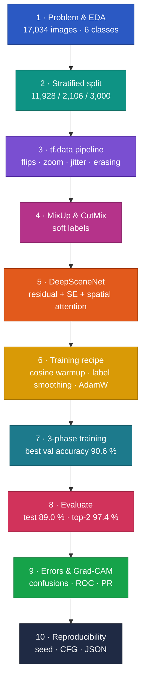

# Intel Scene Classification with a CNN Trained From Scratch


How far can a convolutional network go on natural-scene photos **without any pretrained weights**? This project designs **DeepSceneNet**, a residual CNN with channel and spatial attention, and trains it from random initialisation on the Intel Image Classification dataset using a heavy regularisation recipe and a three-phase learning-rate schedule.

> MSc Data Science project (Applied Data Science 2), University of Hertfordshire. All results come from one complete run on a Kaggle Tesla T4 GPU.

---

## Highlights

| | |
|---|---|
| **Test accuracy** | **89.03 %** on 3,000 held-out images (target ≥ 90 %) |
| **Top-2 accuracy** | **97.37 %** |
| **Model** | DeepSceneNet: 4 residual stages, Squeeze-and-Excitation + spatial attention, **13.1 M parameters**, no transfer learning |
| **Regularisation** | MixUp, CutMix, label smoothing (0.1), random erasing, colour jitter, dropout, L2, AdamW |
| **Training** | Cosine learning rate with warmup, 3 phases (1e-3 → 2e-4 → 5e-5), mixed precision on a Tesla T4 |
| **Explainability** | Confusion matrices, ROC and precision-recall curves, most-confident errors, Grad-CAM |

## Methodology


**[Explore the interactive methodology](https://spoorthihs4-ops.github.io/intel-scene-cnn-from-scratch/)** – click any stage to see what it does, why it matters, the result it produced and the techniques behind it.

<details>
<summary><b>Pipeline as a live diagram (zoom and pan on GitHub)</b></summary>


</details>

## Results

### Per-class performance (test set, standard prediction)

| Class | Precision | Recall | F1 |
|---|---|---|---|
| Forest | 0.961 | 0.987 | 0.974 |
| Sea | 0.897 | 0.935 | 0.916 |
| Street | 0.904 | 0.898 | 0.901 |
| Buildings | 0.893 | 0.874 | 0.883 |
| Mountain | 0.824 | 0.863 | 0.843 |
| Glacier | 0.873 | 0.798 | 0.834 |
| **Macro average** | **0.892** | **0.893** | **0.892** |

- **Where the errors are:** 339 of 3,000 images (11.3 %) are misclassified. Glacier ↔ mountain confusions make up 38 % of them and buildings ↔ street another 20 % - pairs that genuinely share visual content.
- **Test-time augmentation did not help:** 10-pass TTA scored 88.70 % vs 89.03 % for a single pass, so the standard prediction is reported.
- **Small generalisation gap:** best validation accuracy 90.60 % vs 89.03 % on test.

<p align="center">
  
  
</p>
<p align="center">
  
  
</p>

### Next steps to pass 90 %

Train at a higher resolution than 150 px, run longer cosine cycles, ensemble several seeds or snapshots, and add augmentation that targets the glacier/mountain boundary. Transfer learning would also help but was outside the brief.

## Notebooks

| Notebook | Contents |
|---|---|
| [`00_full_pipeline_run_all`](notebooks/00_full_pipeline_run_all.ipynb) | **Everything, top to bottom - run this to reproduce** |
| [`01_problem_definition_and_eda`](notebooks/01_problem_definition_and_eda.ipynb) | Task, setup and configuration, dataset checks, exploratory analysis |
| [`02_preprocessing_and_augmentation`](notebooks/02_preprocessing_and_augmentation.ipynb) | Stratified split, tf.data pipeline, MixUp and CutMix, augmentation visuals |
| [`03_model_architecture`](notebooks/03_model_architecture.ipynb) | DeepSceneNet: residual blocks, SE and spatial attention, architecture diagram |
| [`04_training`](notebooks/04_training.ipynb) | Cosine-warmup schedule, label-smoothed loss, callbacks, three training phases, curves |
| [`05_evaluation_and_explainability`](notebooks/05_evaluation_and_explainability.ipynb) | Test metrics, TTA, reports, confusion matrices, ROC/PR, error analysis, Grad-CAM, reproducibility |

The part notebooks keep the executed outputs for reading; large photo outputs were saved as JPEG so they render on GitHub.

## Reproduce

1. Open [`00_full_pipeline_run_all.ipynb`](notebooks/00_full_pipeline_run_all.ipynb) on **Kaggle** with a **GPU T4** accelerator.
2. Add the dataset [Intel Image Classification](https://www.kaggle.com/datasets/puneet6060/intel-image-classification) as input; the notebook auto-detects `seg_train` and `seg_test`.
3. **Run All.** Training takes about 75 seconds per epoch on a T4.

## Repository structure

```
intel-scene-cnn-from-scratch/
├── notebooks/            # 00 full pipeline + 01-05 part notebooks (with outputs)
├── reports/figures/      # methodology flowchart and result charts
├── docs/index.html       # interactive methodology (GitHub Pages)
├── requirements.txt
└── README.md
```

## Author

**Dr. Spoorthi H S** · MSc Data Science, University of Hertfordshire  
[LinkedIn](https://linkedin.com/in/dr-spoorthi-2005b6351) · [GitHub](https://github.com/spoorthihs4-ops)
